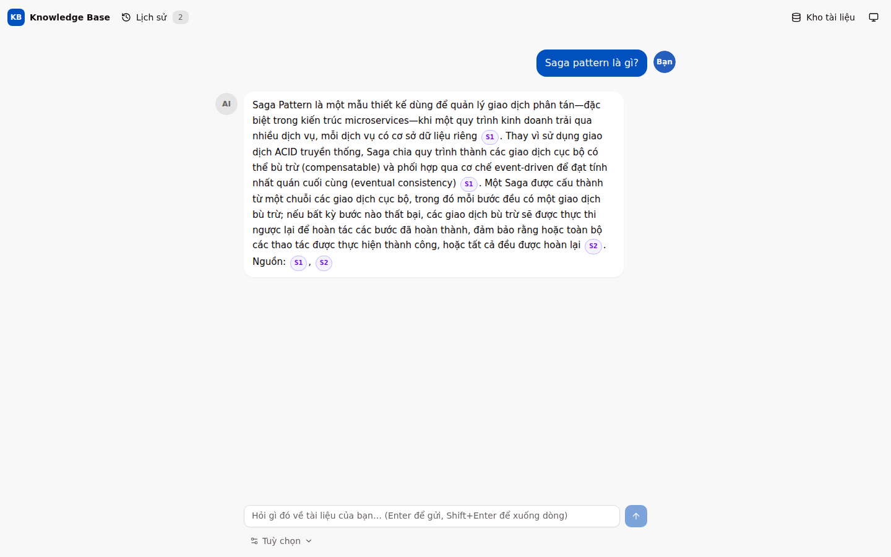
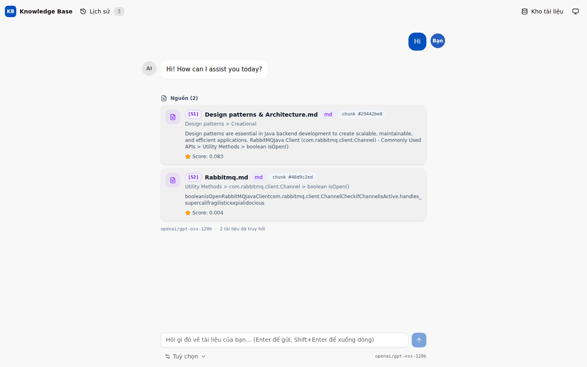
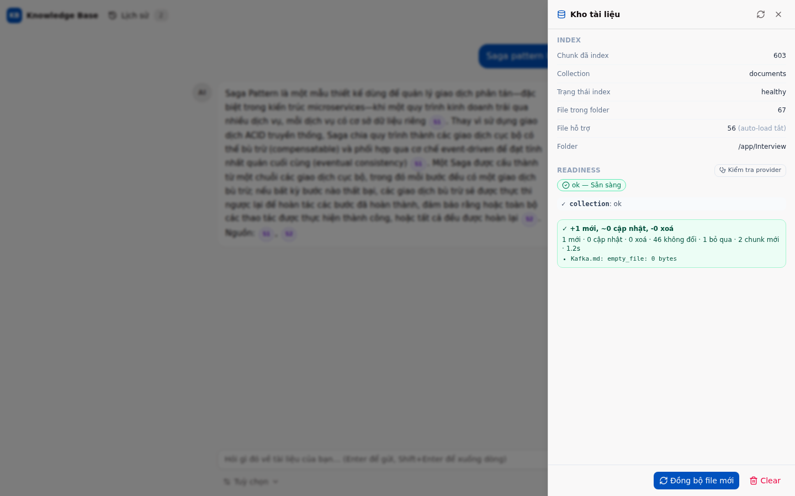
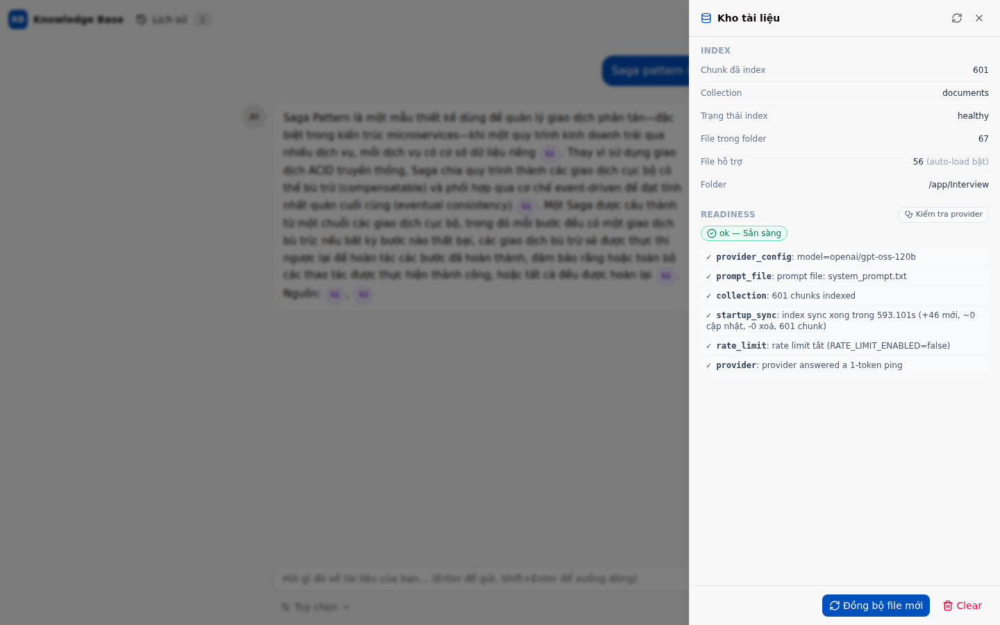

# Knowledge Base — Frontend (Next.js 16)

UI cho backend RAG ở [`../Knowledge-base/`](../Knowledge-base/README.md) (FastAPI + ChromaDB + Groq).
Tổng quan hệ thống: [`../README.md`](../README.md). Quyết định kiến trúc FE:
[ADR-0015](../docs/adr/0015-fe-state-khong-dung-thu-vien.md) ·
[ADR-0016](../docs/adr/0016-render-streaming-plain-text.md).
> Link dạng `../` (`../docs/adr/`, `../Knowledge-base/`, `../README.md`) dùng được cả local lẫn trên
> GitHub vì BE/FE/docs nằm trong **cùng một repo** (monorepo).


> Số liệu **tính đến 2026-11-10**: **132 unit test** (vitest) · **16 e2e** (Playwright) · Next **16** ·
> React **19** · Tailwind **v4**.



## Tech Stack

| Thành phần | Chọn | Ghi chú |
|---|---|---|
| Framework | Next.js **16** (App Router) · React **19** · TypeScript | server components + client islands |
| Style | Tailwind **v4** + Radix/shadcn primitives | theme sáng/tối bằng class `.dark` |
| State | **store ngoài React** + `useSyncExternalStore` + `localStorage` | không Zustand/Redux — ADR-0015 |
| Icons | `lucide-react` | |
| Test | `vitest` + Testing Library · **Playwright** e2e | e2e chạy Chromium thật (WSL, không cần `sudo`) |

## Ports (đừng lẫn)

| Ngữ cảnh | FE | BE |
|---|---|---|
| Dev (`npm run dev`) | **3000** | 8010 (container) hoặc 8000 (uvicorn tay) |
| Docker compose (chạy từ repo BE) | **3010** | **8010** |
| API docs | — | `http://localhost:8010/docs` |

Dời port để không trùng project khác trên máy. `NEXT_PUBLIC_API_PROXY_URL` phải trỏ tới **BE** đúng port.

## Quickstart

```bash
# 1) Backend phải chạy trước (xem ../Knowledge-base/README.md)
curl -s http://localhost:8010/health

# 2) FE — dev
cp .env.example .env.local        # NEXT_PUBLIC_API_PROXY_URL=http://localhost:8010
npm ci
npm run dev                       # http://localhost:3000

# 3) FE — container (dựng cùng BE, từ repo BE)
cd ../Knowledge-base && docker compose up -d --build chatbot-ui   # http://localhost:3010
```

Nếu bật auth ở BE (`AUTH_ENABLED=true`): nhập token ở màn **token gate**; FE lưu token và gửi header
`X-API-Key` cho mọi request.

## Tính năng

### Chat & streaming

- Hỏi đáp trên tài liệu, stream qua SSE `start → token* → (end | error)`.
- Hiện **pha** truy hồi: "Đang truy hồi tài liệu (ns)" → "Đang viết câu trả lời" (KB-4.11).
- Lúc stream hiển thị **plain text**, markdown chỉ parse **1 lần** khi `end` (ADR-0016) — đổi lại: 0 lần
  parse/câu thay vì 300.
- Answer rỗng ⇒ hiện giải thích + nút **Thử lại** (không để bubble trống).
- Badge nguồn `[S1]…` chỉ xuất hiện sau `end`; panel **Nguồn** hiện path + snippet (không tràn ngang).



### Kho tài liệu (drawer)

- **Đồng bộ file mới** = index tăng dần (BE `POST /documents/sync`): chỉ file mới/đổi; **không** xoá index
  ⇒ chat vẫn dùng được trong lúc sync. (Nút "Refresh toàn bộ" đã bỏ — chỉ còn ở BE cho cứu hộ bằng curl.)
- Hiện `document_count`, `collection`, `index_version`, cache rerank, trạng thái **startup sync** (BE index
  nền lúc khởi động).
- **Readiness**: liệt kê **mọi** check của `/ready` (✓/✗ + detail) + nút **Kiểm tra provider** gọi
  `/ready?deep=true` (BE ping provider 1 request `max_tokens=1` — chỉ bấm khi cần).
- **Clear**: phải gõ `CLEAR` mới bấm được (tránh xoá index do nhầm).




### Lịch sử hội thoại

- **Server là nguồn sự thật**: `GET /conversations` (máy khác/cache trống vẫn thấy hội thoại);
  `DELETE /conversations/{id}` xoá.
- `localStorage` (`kb.chat.v2`) là **cache/fallback**: BE tắt hoặc timeout ⇒ vẫn dùng được lịch sử, không
  trắng màn hình. Ghi `localStorage` **debounce 300 ms** khi stream.
- Nhiều hội thoại, F5 không mất; tiêu đề tự sinh từ message đầu.

### Theme & layout

- Sáng/tối (lưu `localStorage`), tôn trọng `prefers-color-scheme` lần đầu.
- Responsive: 720 px (drawer thay sidebar), 1440 px, 1900 px — e2e assert **không tràn ngang**.

## Scripts

| Lệnh | Việc |
|---|---|
| `npm run dev` | dev server (:3000, hot reload) |
| `npm run test` | **vitest** — 132 test |
| `npm run test:watch` | vitest watch |
| `npm run lint` | ESLint |
| `npm run typecheck` | `tsc --noEmit` |
| `npm run build` | production build |
| `npm run test:e2e` | **Playwright** — tự bật dev server (:3000) nếu chưa chạy |
| `npm run test:e2e:prod` | Playwright trên container (:3010) — prod parity |
| `npm run test:all` | unit + e2e |

Chuẩn bị Playwright (một lần, **không cần `sudo`**): `bash tools/setup-playwright.sh` (tải `.deb` X11 rồi
`dpkg -x` vào `~/.local/pw-libs`, xem `playwright.config.ts`).

## e2e checks (16)

`npx playwright test --list` → **Total: 16 tests in 1 file**.

| # | Check | Ticket |
|---|---|---|
| 1 | header có brand, đúng **một** nút "Kho tài liệu", toggle theme | KB-4.9 / 5.13 |
| 2 | ngăn kéo: brand trên, nút đóng trong khung, không đè nút Tạo mới | KB-5.12 |
| 3 | 720 px: không sidebar, drawer Lịch sử mở được, không tràn ngang | KB-4.9 |
| 4 | theme sáng → tối: `.dark` + `color-scheme` + `localStorage` | KB-4.8 |
| 5 | F5 vẫn thấy hội thoại + tiêu đề session (`localStorage`) | KB-4.9 |
| 6 | Sheet: `role=dialog`, focus trong sheet, ESC đóng | KB-4.8 |
| 7 | Readiness: liệt kê mọi check + nút **Kiểm tra provider** gọi `?deep=true` | **KB-5.17** |
| 8 | Nguồn dài (path + snippet) không tràn ngang | KB-4.5 |
| 9 | 1900 px không tràn ngang | KB-4.9 |
| 10 | Canh mép: composer + panel Nguồn thẳng mép bubble | KB-4.8 |
| 11 | Stream: chip `[S1]` chỉ xuất hiện sau `end` (không parse markdown mỗi token) | KB-5.6 |
| 12 | Pha truy hồi: "Đang truy hồi tài liệu" rồi "Đang viết câu trả lời" | KB-4.11 |
| 13 | Answer rỗng: giải thích + nút Thử lại, không bubble trống | KB-4.11 |
| 14 | Đồng bộ file mới ⇒ hiện kết quả, không còn nút Refresh toàn bộ | KB-5.1 |
| 15 | Máy khác (localStorage rỗng) vẫn thấy hội thoại từ server + nạp messages | KB-5.2 |
| 16 | BE tắt (mọi endpoint lỗi) ⇒ vẫn dùng lịch sử `localStorage`, không trắng màn hình | KB-5.2 |

## Env (`NEXT_PUBLIC_*`)

| Biến | Mặc định | Ghi chú |
|---|---|---|
| `NEXT_PUBLIC_API_PROXY_URL` | `http://localhost:8000` (code) · compose đặt `http://localhost:8010` | URL **BE** |
| `NEXT_PUBLIC_*` khác | — | giá trị được **nhúng lúc build** ⇒ đổi phải rebuild container |

Token auth (KB-5.5) **không** nằm trong env: nhập ở UI, lưu `localStorage`, gửi qua `X-API-Key`.

## Cấu trúc source

```
Knowledge-base-fe/
├── app/                    # App Router: page.tsx (chat), layout, globals.css
├── components/
│   ├── app-header.tsx · app-sidebar.tsx · chat-composer.tsx
│   ├── chat-messages.tsx · message-with-citations.tsx · sources-panel.tsx
│   ├── documents-panel.tsx # drawer Kho tài liệu + readiness (KB-5.17)
│   ├── token-gate.tsx · stream-status.tsx
│   └── ui/                 # shadcn primitives (button, sheet, dialog…)
├── lib/
│   ├── api.ts              # client API duy nhất (ApiError, SSE parser)
│   ├── chat-store.ts       # store + localStorage (ADR-0015)
│   ├── conversations.ts · stream-phase.ts · sse.ts · types.ts · errors.ts
├── tests/                  # vitest (132)
├── e2e/ui.spec.ts          # Playwright (16)
├── docs/images/            # ảnh chụp dùng trong README này
└── tools/setup-playwright.sh
```

## Troubleshooting

| Triệu chứng | Nguyên nhân | Xử lý |
|---|---|---|
| "Không kết nối được tới server" | sai `NEXT_PUBLIC_API_PROXY_URL` hoặc BE chưa chạy | `curl :8010/health`; sửa env rồi **rebuild** (giá trị nhúng lúc build) |
| CORS error trên console | origin FE không nằm trong `ALLOWED_ORIGINS` của BE | thêm `http://localhost:3010` (hoặc `:3000`) vào `.env` BE |
| 401 mọi request | BE bật `AUTH_ENABLED=true` | nhập token ở màn token gate |
| 429 | rate limit của BE (`RATE_LIMIT_ENABLED=true`) | chờ theo `Retry-After` |
| e2e fail "browser not found"/thiếu lib X11 | chưa chạy setup | `bash tools/setup-playwright.sh` |
| Theme nháy khi tải | đọc `localStorage` trong lúc render | đã xử lý bằng `useSyncExternalStore` + server snapshot rỗng (ADR-0015) |

## Liên quan

- Backend + index/retrieval: [`../Knowledge-base/README.md`](../Knowledge-base/README.md)
- Tổng quan + quickstart 2 cách: [`../README.md`](../README.md)
- Vì sao (17 ADR): [`../docs/adr/README.md`](../docs/adr/README.md)


