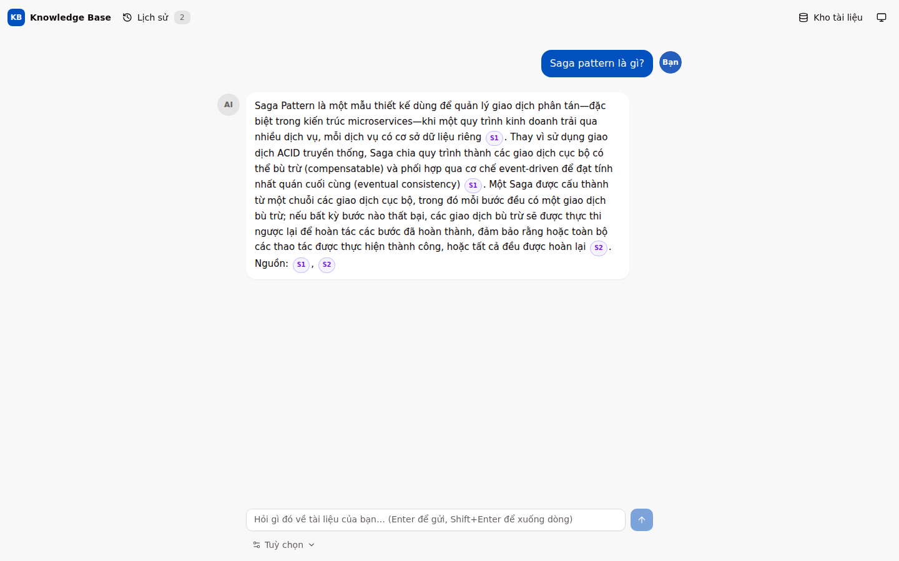
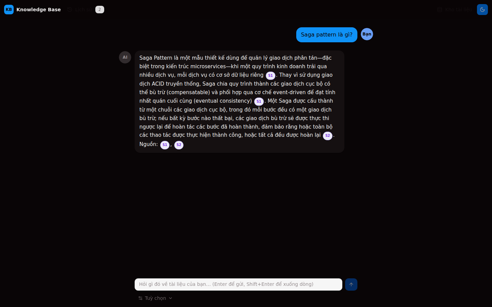

# Knowledge Base — RAG chatbot cho tài liệu cá nhân

> **Public showcase repo.** Đây là bản gộp **read-only** của 3 repo GitLab (`knowledge-base-be`,
> `knowlege-base-fe`, `knowledge-base-root`) để có một link duy nhất cho portfolio. Code được phát
> triển trên GitLab; bản này đồng bộ bằng [`sync.sh`](sync.sh) và **không nhận pull request**.
>
> **Không có dữ liệu cá nhân.** Kho tài liệu cá nhân (`Interview/`) đã bị loại khỏi **toàn bộ lịch sử**
> của repo này. Muốn chạy thử: tạo `Knowledge-base/Interview/` rồi thả file `.md` của bạn vào đó
> (thư mục này nằm trong `.gitignore`, nên tài liệu của bạn sẽ không bị commit).
>
> **English summary.** A RAG assistant over my own technical notes: FastAPI + ChromaDB with hybrid
> retrieval (dense Qwen3-Embedding 0.6B + BM25, fused and deduplicated), cross-encoder reranking to
> the top 6, SSE streaming answers with `[S1]`-style citations, and PII/secret redaction before any
> provider call. Quality is measured, not claimed: a 28-question golden set with a JSON snapshot per
> run (`hit@k` / `MRR` / `precision@k` / duplicate ratio / p50 latency). 300+ backend tests, 132
> frontend tests, 16 Playwright e2e, 17 ADRs.

Hỏi đáp trên **chính tài liệu của bạn** (ghi chú kỹ thuật, ôn phỏng vấn, tài liệu tự học) bằng RAG:
retrieval local trên CPU, sinh câu trả lời bằng LLM free tier, **che PII trước khi gửi ra ngoài**, và mọi
quyết định kiến trúc đều có ADR kèm **số đo thật**.

Điểm đáng chú ý (portfolio): **2.879 chunk / 234 file**, retrieval `hit@k 0,964` / `MRR 0,833` trên bộ vàng
**28 câu** (41 lần chạy eval có snapshot), p50 **3,2 s**/câu trên CPU, **300+ unit test** + **132 FE test** +
**16 e2e**, image BE **2,68 GB** (từ 16,5 GB), CI có sẵn nhưng **gate tắt mặc định**. Số liệu **tính đến
2026-11-10** — chi tiết từng lần chạy ở [`Knowledge-base/eval/runs/`](Knowledge-base/eval/runs/).




> Chỉ muốn **chạy thử** ⇒ đọc [Quickstart](#quickstart). Muốn hiểu **vì sao** hệ thống như hiện tại ⇒
> [`docs/adr/README.md`](root/docs/adr/README.md) (17 ADR + 3 lộ trình đọc + 28 câu ôn tập).

## Hệ thống gồm gì

Hai repo độc lập trên GitLab (ở đây là 2 thư mục), cộng tài liệu/AI assets ở `root/`:
`Knowledge-base/` (backend), `Knowledge-base-fe/` (frontend), `root/` (architecture, ADR, backlog).

```
Browser
   │  http://localhost:3010  (compose)  |  :3000 (dev)
   ▼
Next.js 16 (FE)  ──── SSE / JSON ────►  FastAPI (BE) :8010
   • chat + sources                     • /chat, /chat/stream (SSE)
   • drawer Kho tài liệu                • /documents/sync|refresh|status|clear
   • lịch sử (server là sự thật)        • /conversations (SQLite WAL)
   • theme sáng/tối                     │
                                        ├─► ChromaDB (./chroma_db, 2.879 chunk)
                                        │     dense (Qwen3-Embedding 0.6B, CPU float32)
                                        │     + sparse BM25  → dedup → rerank top-6
                                        └─► LLM: Groq (OpenAI-compatible), sau khi redact PII
```

| Thành phần | Port | Ghi chú |
|---|---|---|
| FE (docker compose) | **3010** | `chatbot-ui` |
| FE (dev) | **3000** | `npm run dev` |
| BE (docker compose) | **8010** | `chatbot-api`, container lắng nghe 8000 |
| BE (dev tay) | 8000 | `uvicorn --port 8000` |
| API docs | 8010/docs | Swagger UI |

## Quickstart

### Cách 1 — Docker compose (nhanh nhất)

```bash
cd Knowledge-base
cp .env.example .env            # điền OPENAI_API_KEY (Groq) + OPENAI_BASE_URL
docker compose up -d --build    # lần đầu: build ~60-90 s + tải model ~3,3 GB vào volume
docker compose ps               # chatbot-api + chatbot-ui đều "healthy"
open http://localhost:3010      # UI
```

### Cách 2 — dev tay (sửa code, hot reload)

```bash
# BE
cd Knowledge-base
uv venv --python 3.13 .venv && uv pip install -r requirements.txt -r requirements-dev.txt
cp .env.example .env            # điền key
.venv/bin/python -m uvicorn app.main:app --port 8000 --reload

# FE (terminal khác)
cd Knowledge-base-fe
cp .env.example .env.local      # NEXT_PUBLIC_API_PROXY_URL=http://localhost:8000
npm ci && npm run dev           # http://localhost:3000
```

**File `.env` nào cần**: `Knowledge-base/.env` (BE: key LLM + đường dẫn index/DB) và
`Knowledge-base-fe/.env.local` (FE: URL BE). Biến **tối thiểu** để chạy: `OPENAI_API_KEY`,
`OPENAI_BASE_URL`. Không commit `.env` (rule PII/secret — xem `AGENTS.md` §9.5).

## Cấu trúc source

```
knowledge-base/                  # root: git repo riêng — track tài liệu + AI assets (ignore 2 repo con)
├── README.md                    # file này — cửa vào chung
├── architecture.md              # hiện trạng kiến trúc (luồng dữ liệu, env, roadmap)
├── Backlog.md                   # ticket theo phase + tech debt (§7) + changelog
├── AGENTS.md                    # working agreement (cách làm việc với AI agent)
├── docs/
│   ├── adr/                     # 17 ADR + README (lộ trình đọc + 28 câu ôn tập)
│   └── phases/                  # nhật ký từng phase (có gì · cách chạy · bài học)
├── .clinerules/ .cline/         # rules/skills/workflows cho AI agent
├── tools/                       # pii_scan.py, verify.sh, setup-wsl-docker-engine.sh
│
├── Knowledge-base/              # BE — git repo riêng (GitLab)
│   ├── app/main.py              # routes + middleware + error handlers
│   ├── app/core/                # config, errors, auth, rate_limit, sse, provider_retry
│   ├── app/services/            # document_service (index/retrieval/rerank), chat_service,
│   │                            # index_sync, rerank_cache, multi_query, dedup, pii_service,
│   │                            # conversation_store, startup_sync, health_service
│   ├── tests/                   # 300+ test
│   ├── eval/                    # bộ vàng 28 câu + runs/*.json (số đo)
│   └── Dockerfile · docker-compose.yml
│
└── Knowledge-base-fe/           # FE — git repo riêng (GitLab)
    ├── app/                     # App Router (page.tsx = màn chat)
    ├── components/              # header/sidebar/composer/messages/documents-panel/ui
    ├── lib/                     # api.ts, chat-store.ts (state), sse.ts, types.ts
    ├── tests/                   # 132 vitest
    ├── e2e/ui.spec.ts           # 16 Playwright checks
    └── docs/images/             # ảnh chụp dùng trong README
```

## Luồng dữ liệu end-to-end

**Thêm tài liệu** → **hỏi** → **trả lời**:

```
1) bạn thả file .md vào Knowledge-base/Interview/
2) BE (startup hoặc nút "Đồng bộ file mới"):
     scan folder → sha256(nội dung)[:16] → diff với index
     → chunk (heading → 1000 ký tự / overlap 200) → embed Qwen3 (fp32, CPU) → Chroma
3) bạn hỏi:  "So sánh JPA và Hibernate, khi nào dùng cái nào?"
     → tách ≤3 ý (heuristic) → mỗi ý: hybrid dense+BM25 (20 ứng viên)
     → dedup + cap 2 chunk/file → rerank cross-encoder top-6 → 3 chunk vào prompt
     → **redact PII** (câu hỏi + context + history) → Groq → stream token về FE
4) FE hiện plain text khi stream, parse markdown 1 lần khi `end`, kèm nguồn [S1]…
```

Số đo để bạn biết "nhanh hay chậm": sync **~1,2 s/file** (không đổi gì: 0,03 s) · re-index toàn bộ
**7,3 phút** (601 chunk, corpus cũ) · hỏi câu **mới** p50 **3,2 s** · câu **lặp** **0,13 s** (cache).

## Tài liệu ở đâu

| Muốn biết | Đọc |
|---|---|
| Chạy thế nào, endpoint nào, env nào | [`Knowledge-base/README.md`](Knowledge-base/README.md) · [`Knowledge-base-fe/README.md`](Knowledge-base-fe/README.md) |
| Hệ thống hiện tại gồm gì (luồng, layer, env, roadmap) | [`architecture.md`](root/architecture.md) |
| **Vì sao** lại chọn thế (kèm số đo + anti-pattern) | [`docs/adr/README.md`](root/docs/adr/README.md) |
| Đang làm gì, nợ kỹ thuật, lịch sử thay đổi | [`Backlog.md`](root/Backlog.md) |
| Nhật ký từng phase (có gì, cách chạy lúc đó, bài học) | [`docs/phases/`](root/docs/phases/) |
| Cách làm việc với AI agent trong repo | [`AGENTS.md`](root/AGENTS.md) |

## Repo & git

| Repo | Nội dung | Remote |
|---|---|---|
| `Knowledge-base/` | backend | GitLab `knowledge-base-be` |
| `Knowledge-base-fe/` | frontend | GitLab `knowlege-base-fe` |
| root (thư mục này) | tài liệu, ADR, AI assets, `tools/` | local `main` (chưa có remote) |

Root là git repo riêng và **ignore 2 folder repo con** (`.gitignore`) ⇒ không file nào bị track 2 lần.
Commit tài liệu root độc lập với 2 repo app:

```bash
git -C . status            # root repo
git -C Knowledge-base status        # BE repo
git -C Knowledge-base-fe status     # FE repo
```


## Điểm kỹ thuật đáng chú ý

| Chủ đề | Làm gì | Bằng chứng |
|---|---|---|
| Retrieval | hybrid dense+BM25 → dedup/cap → rerank cross-encoder, `RERANK_TOP_N=6` | `hit@k 0,964` · `MRR 0,833` · p50 **3,2 s** ([eval](Knowledge-base/eval/runs)) |
| Index | incremental theo `sha256(nội dung)` + guard folder rỗng | **1,2 s/file** vs 22 phút clear+reload |
| Embedding | Qwen3-0.6B local CPU, ép **fp32** (bf16 trên CPU chậm 3–4×) | 601 chunk (corpus cũ): 22 phút → **7,3 phút** |
| An toàn | redact PII/secret **trước khi** gửi LLM, trước khi lưu history | 300+ test + `tools/pii_scan.py` |
| Vận hành | `/health` (liveness) + `/ready` (3 check rẻ, `?deep=true` ping provider) + sync **chạy nền** | `/health` 200 sau **5,6 s** khi index nền (601 chunk) |
| Chi phí | LLM free tier, embedding/rerank local ⇒ **0 đồng/tháng** | 1 cổng provider + retry có ngân sách, không vượt TPM |
| Chất lượng code | 300+ test BE · 132 test FE · 16 e2e · 17 ADR có số đo | `pytest -q` · `npm run test` · `npx playwright test --list` |
| CI | 2 repo có `.gitlab-ci.yml`, **gate `CI_ENABLED` mặc định TẮT** | không tạo pipeline trừ khi bật biến |

Ảnh giao diện: [kho tài liệu + readiness](Knowledge-base-fe/docs/images/readiness-checks.png) ·
[panel nguồn](Knowledge-base-fe/docs/images/sources-panel.png) ·
[theme tối](Knowledge-base-fe/docs/images/home-dark.png).
(Ảnh do Playwright sinh khi chạy e2e, copy vào `Knowledge-base-fe/docs/images/` để README hiển thị được.)

## Troubleshooting chung

| Triệu chứng | Xử lý nhanh |
|---|---|
| UI "Không kết nối được tới server" | `curl http://localhost:8010/health`; kiểm `NEXT_PUBLIC_API_PROXY_URL` rồi **rebuild** FE (giá trị nhúng lúc build) |
| `/ready` = `degraded` (`collection is empty`) | `curl -X POST http://localhost:8010/documents/sync` |
| `409 documents_folder_empty` | `DOCUMENTS_FOLDER` sai hoặc bị `.dockerignore` loại — kiểm `docker compose exec chatbot-api ls /app/Interview` |
| Container chậm healthy lần đầu | đang tải model ~3,3 GB vào volume `hf-cache` (một lần) |
| `429 provider_rate_limited` | hết TPM free tier — chờ, giữ `PROVIDER_MAX_CONCURRENCY=1` |
| Đổi `CHUNK_SIZE`/`EMBEDDING_*` mà kết quả không đổi | `sync` chỉ so nội dung file ⇒ `DELETE /documents/clear` rồi `POST /documents/sync` |
| Câu trả lời luôn ~3–4 s | rerank CPU là chi phí thật; câu lặp đã cache (0,13 s) |

Chi tiết theo repo: [BE Troubleshooting](Knowledge-base/README.md#troubleshooting) ·
[FE Troubleshooting](Knowledge-base-fe/README.md#troubleshooting).

## Giới hạn đã biết (không giấu)

- **Chưa deploy**: chỉ chạy local (docker compose). Chưa có registry/deploy tự động (TD-24, **Skip**).
- **Rerank CPU** ~3,4 s cho câu mới — muốn < 2 s cần GPU hoặc model nhỏ hơn.
- **1 worker** uvicorn (mỗi worker nạp 1 bản model) ⇒ rate limit + semaphore là per-process (TD-17, **Skip**).
- **PII redaction bằng regex** — không bắt được PII viết tự do (tên, địa chỉ) (TD-1, đã đóng có chủ ý).
- **Bộ eval 28 câu** do chính tác giả viết ⇒ thiên lệch theo tài liệu hiện có.

## License

MIT. Tài liệu viết tiếng Việt (keyword kỹ thuật giữ tiếng Anh); ADR chỉ có bản tiếng Việt.


